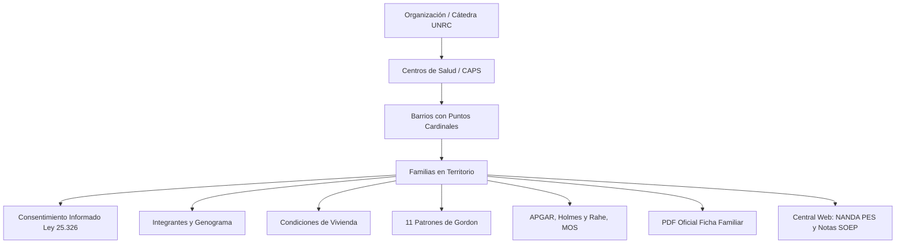

# Manual de Uso y Funcionalidades — Plataforma CuidaRed

**CuidaRed** es una aplicación web progresiva (**PWA**) de salud comunitaria y familiar orientada a la atención primaria, diseñada bajo el marco metodológico de la Escuela de Enfermería (UNRC, Jacquier et al., 2014) y los 11 Patrones Funcionales de Marjory Gordon. 

Funciona bajo el paradigma **offline-first** (opera completamente sin conexión a internet en el territorio y sincroniza automáticamente al recuperar señal) y cumple estrictamente con la **Ley Nacional N° 25.326 de Protección de Datos Personales de Argentina** (no almacena números de DNI ni nombres de pila de las familias).

---

## 1. Arquitectura de Datos y Entidades Iniciales

Para comprender el flujo del sistema, la información se organiza de forma jerárquica:

---

## 2. Guía Paso a Paso: Cómo Ingresar los Datos Iniciales

### A. Usuario de la plataforma (¿Cómo me identifico?)

Existen dos formas de ingresar al sistema:

1. **Modo de Prueba Local (Demo)**:
   - En la pantalla de login ([http://localhost:5173/login](http://localhost:5173/login)), en el recuadro **"Modo de prueba local (Demo)"**:
     - Clic en **`Estudiante (Campo)`**: Inicia sesión con el rol `valorador` (acceso a relevamiento barrial, familias, escalas y PDF).
     - Clic en **`Docente (Central)`**: Inicia sesión con el rol `supervisor` (acceso a la Central Web de auditoría, diagnósticos NANDA, matriz FODA y CSV).
2. **Modo Nube (Producción / Firebase real)**:
   - El sistema opera con **acceso cerrado por invitación** para preservar la confidencialidad sanitaria.
   - La cátedra o el administrador da de alta el correo en la colección `invitaciones/{email}` indicando el rol (`valorador` o `supervisor`) y los CAPS habilitados.
   - El usuario pulsa **"Continuar con Google"**, el sistema verifica la invitación en milisegundos y le otorga acceso.

---

### B. Centro de Salud (CAPS y Organización)

- **¿Dónde reside?**: En el modelo de datos de CuidaRed, el Centro de Atención Primaria de la Salud (CAPS) está vinculado a la Organización (`orgId: org-unrc-enfermeria`).
- **Asignación automática**: Cada usuario tiene asignados los CAPS donde realiza sus prácticas comunitarias (por ejemplo: `CAPS Alberdi`, `CAPS Centro`, etc.).
- Al ingresar como estudiante o docente, la aplicación toma automáticamente el CAPS asignado activo y lo muestra en el encabezado de bienvenida:
  > *Hola, Estudiante · CAPS Alberdi*
- Todas las familias y barrios que cargues quedarán asociados a la cobertura de ese centro de salud.

---

### C. ¿Cómo registrar un Barrio?

Antes de relevar una familia, es necesario tener al menos un barrio registrado:

1. Ingresá al **Inicio** de la aplicación (en el celular o navegador).
2. En la sección superior **"Barrio activo"**, hacé clic en el botón **`+ Nuevo`** (ícono de suma).
3. Se abrirá el modal **"Registrar nuevo barrio"** con los siguientes campos:
   - **Nombre del barrio**: Escribí el nombre (ejemplo: *Alberdi*, *Banda Norte*, *Las Delicias*, *Oncativo*).
   - **Punto cardinal territorial**: Tocá en la brújula el cuadrante correspondiente (**N**orte, **S**ur, **E**ste u **O**este).
4. El sistema armará automáticamente la denominación oficial: ej. `Barrio Alberdi (Sur)`.
5. Hacé clic en **"Guardar barrio"**.
6. El nuevo barrio queda seleccionado como el **Barrio activo**. Si tenés varios barrios, podés alternar entre ellos tocando las etiquetas tipo *chips* horizontales.

---

### D. ¿Cómo registrar y valorar una Familia?

Una vez seleccionado el barrio activo:

#### Paso 1: Alta de la Familia
1. Tocá en la barra inferior la pestaña **`Familias`** (o el botón *Familias* en la pantalla principal).
2. Hacé clic en el botón superior **`+ Nueva Familia`**.
3. Completá los datos solicitados:
   - **Barrio**: Seleccioná el barrio al que corresponde el domicilio.
   - **Apellido representativo**: Escribí el apellido familiar (ejemplo: *Gómez*, *Pérez*). *Recordá: por Ley 25.326 no se registran nombres de pila ni DNIs.*
   - **Domicilio**: Calle y número, o manzana y lote (ejemplo: *Salta 450* o *Mz. 12 Lote 4*).
   - **Parentesco del referente que atiende**: Elegí quién recibe al equipo (ej. *Madre*, *Jefa de hogar*, *Padre*, *Abuela*).
   - **¿Convivencia / Familia 2?**: Si en el mismo lote o terreno convive otra familia independiente, marcá esta casilla para que el sistema le asigne automáticamente el número de orden de convivencia (ej. *Familia 2*).
   - **Detección de duplicados**: Si escribís un domicilio o apellido similar a uno ya cargado, la pantalla te alertará para que no dupliques fichas existentes.
4. Hacé clic en **"Registrar familia"**.
5. Se generará de inmediato el **Código Familiar Único** (ejemplo: `B-S-GOM-1024`).

#### Paso 2: Consentimiento Informado (Ley 25.326)
1. Al tocar la tarjeta de la familia recién creada, entrarás a su **Ficha Familiar**.
2. Arriba verás una alerta: *"Consentimiento pendiente"*.
3. Hacé clic en **`Registrar consentimiento`**.
4. Leé o explicá verbalmente a la persona referente el propósito docente, asistencial y la confidencialidad de los datos.
5. Marcá la casilla de consentimiento otorgado y hacé clic en **Confirmar**.

#### Paso 3: Carga de Integrantes
1. En la Ficha Familiar, tocá en la sección **Integrantes**.
2. Hacé clic en **`+ Agregar integrante`**.
3. Completá:
   - **Parentesco**: *Jefe/a de hogar*, *Cónyuge*, *Hijo/a*, *Abuelo/a*, etc.
   - **Edad** y **Sexo biológico**.
   - **Ocupación / Escolaridad**.
   - **Condiciones crónicas**: Si presenta hipertensión (HTA), diabetes (DBT), asma, etc.
4. Podés registrar las parejas para conformar la estructura del genograma familiar.

#### Paso 4: Condiciones de la Vivienda y Entorno
1. En la sección **Vivienda**, registrá:
   - Material predominante (mampostería, chapa, madera, precaria).
   - Acceso a agua potable (red pública, pozo, canilla comunitaria).
   - Disposición de excretas (cloacas, cámara séptica, letrina).
   - Electricidad, calefacción y recolección de residuos.
   - Presencia de hacinamiento crítico (relación personas/habitaciones).

#### Paso 5: Valoración de los 11 Patrones Funcionales de Gordon
1. En la Ficha Familiar, hacé clic en **`Valorar Patrones de Gordon`**.
2. Se abre un *stepper* guiado paso a paso por los 11 nodos clínicos:
   1. *Percepción y mantenimiento de la salud*
   2. *Nutricional - Metabólico*
   3. *Eliminación*
   4. *Actividad - Ejercicio*
   5. *Sueño - Descanso*
   6. *Cognitivo - Perceptivo*
   7. *Autopercepción - Autoconcepto*
   8. *Rol - Relaciones*
   9. *Sexualidad - Reproducción*
   10. *Adaptación - Tolerancia al estrés*
   11. *Valores - Creencias*
3. Para cada patrón podés tildar los indicadores observados, escribir notas de campo y emitir el **Veredicto Clínico**:
   - 🟢 **Funcional / Estructural**: Sin alteraciones.
   - 🟡 **En Riesgo**: Factores de riesgo presentes.
   - 🔴 **Disfuncional / Alterado**: Problema evidente detectado.
4. Al marcar un patrón alterado o en riesgo, el sistema activa el **Asistente NANDA**, sugiriendo diagnósticos de enfermería relacionados.

#### Paso 6: Aplicación de Instrumentos Psicosociales
En la pestaña **Instrumentos** de la ficha, podés aplicar las escalas estandarizadas del libro de la cátedra:
- **APGAR Familiar (Smilkstein)**: 5 preguntas sobre adaptabilidad, participación, gradación de recursos, afecto y resolución. Clasifica la familia en *Buena función familiar*, *Disfunción leve/moderada* o *Disfunción severa*.
- **Escala de Reajuste Social (Holmes y Rahe)**: Inventario de 43 acontecimientos vitales estresantes ocurridos en los últimos 12 meses (duelo, pérdida de empleo, mudanza, deudas, etc.). Calcula el riesgo psicosomático (*Bajo*, *Moderado*, *Alto*).
- **Cuestionario de Apoyo Social MOS**: 19 ítems que evalúan el apoyo emocional, instrumental, afectivo y de interacción positiva.
- El sistema muestra un **Semáforo Psicosocial Integrado** con alertas automáticas.

#### Paso 7: Generación de la Ficha Familiar en PDF (Offline)
1. En la parte superior de la Ficha Familiar, hacé clic en **`Descargar Ficha PDF`**.
2. El motor genera en el propio dispositivo (sin enviar datos a servidores externos) un documento formal de 2 páginas que incluye:
   - Encabezado institucional con CAPS y código familiar.
   - **Anillo de Gordon vectorial en color**: círculo con los 11 cuadrantes coloreados según su veredicto (verde, amarillo, rojo).
   - Resumen de integrantes, vivienda y escalas psicosociales.
   - Cuadro para firmas del estudiante valorador y del docente supervisor.

---

## 3. Central Web de Supervisión y Docencia (`/central`)

Diseñada para computadoras de escritorio y tablets de docentes supervisoras:

1. **Dashboard General (`/central`)**:
   - Cobertura global de familias relevadas y categorizadas.
   - Índice de disfunción familiar y alertas psicosociales activas.
   - Distribución cardinal de familias por barrio.
2. **Barrios y FODA (`/central/barrios`)**:
   - Análisis de la valoración comunitaria con matriz 2x2: Fortalezas, Oportunidades, Debilidades y Amenazas.
3. **Familias (`/central/familias`)**:
   - Tabla densa con búsqueda por código, barrio y estado.
   - Botón **`Exportar CSV`**: descarga directa de la base de datos para análisis epidemiológico y estadístico en Excel o SPSS.
4. **Diagnósticos de Enfermería (`/central/diagnosticos`)**:
   - Visualización de propuestas diagnósticas formuladas en formato **PES**:
     - **P**: Problema (Etiqueta NANDA).
     - **E**: Etiología (Factores relacionados o de riesgo).
     - **S**: Signos y Síntomas (Características definitorias observadas).
   - Flujo de aprobación docente: la supervisora puede marcar cada diagnóstico como **`Confirmado`**, **`Propuesto`** o **`Descartado`**, agregando observaciones pedagógicas.
5. **Plan de Cuidados y Notas SOEP (`/central/familias/:id/plan`)**:
   - Metas e intervenciones de enfermería priorizadas.
   - Registro de evolución longitudinal con formato **SOEP**:
     - **S**ubjetivo: Lo expresado por la familia.
     - **O**bjetivo: Datos clínicos, signos vitales y observaciones.
     - **E**valuación: Juicio crítico del equipo de enfermería.
     - **P**lan: Acciones inmediatas o citas programadas con el CAPS.
6. **Resolución de Duplicados (`/central/duplicados`)**:
   - Comparación lado a lado de fichas con domicilios o apellidos similares.
   - Permite fusionar registros duplicados o confirmar cohabitación independiente en el mismo lote (*Familia 2*).

---

## 4. Estado Offline y Sincronización

- **Badges de estado**:
  - 🟢 **Enviado / Sincronizado**: Los datos ya impactaron en la base central.
  - 🟡 **Pendiente local**: Se guardó en el almacenamiento del celular y se subirá automáticamente cuando haya conexión.
  - 🔴 **Revisar**: Registro con inconsistencia para verificar.
- **Pantalla `/sincronizar`**:
  - Muestra la cantidad exacta de operaciones pendientes.
  - Botón **`Sincronizar ahora`**: fuerza la transmisión si hay señal WiFi/4G.
  - Botón **`Exportar resguardo JSON`**: permite descargar una copia de seguridad en archivo antes de salir a zonas sin conectividad.
  - Botón **`Limpiar datos locales`**: borra la memoria del navegador del celular al finalizar la rotación para cumplir con la Ley 25.326 en dispositivos personales.
